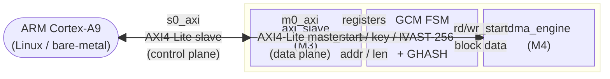
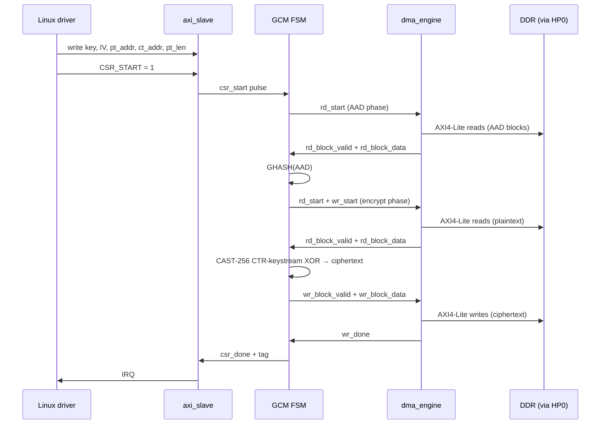
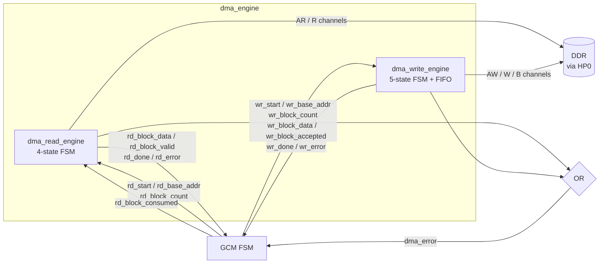
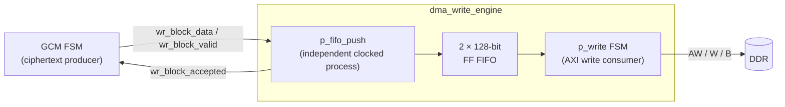
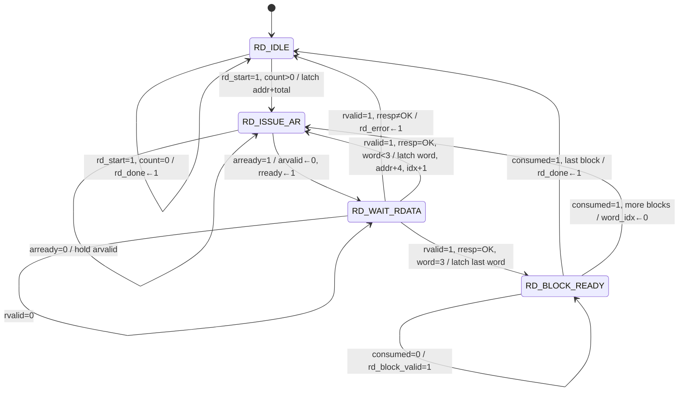
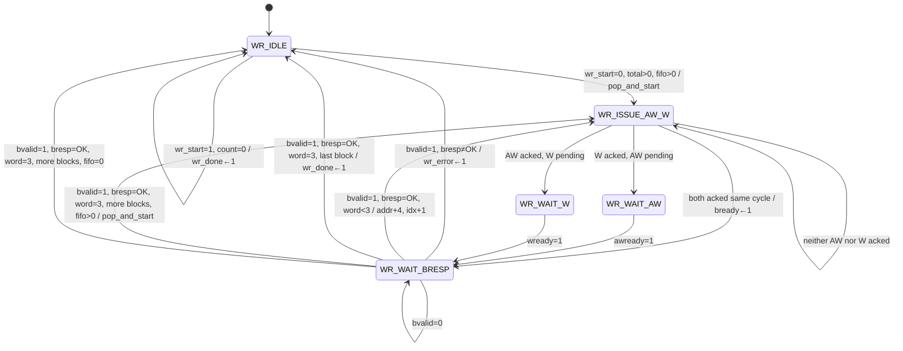
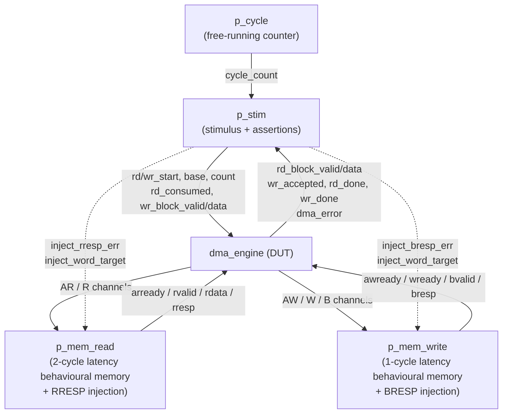

# DMA Engine - Design Review

**Milestone 4 · CAST-256-GCM Accelerator**

---

## 1. Position in the Project

The accelerator is a custom PL (programmable logic) peripheral on a Zynq-7010 SoC.
The processor (PS) configures it over an AXI4-Lite slave bus (`s0_axi`) and the
hardware then autonomously moves data between DDR and the GCM datapath over a
second AXI4-Lite master bus (`m0_axi`).  The DMA engine owns that master bus
entirely.



**Data flow for one GCM encryption:**



---

## 2. Source File Structure

```
vhdl/dma/
├── dma_read_engine.vhd   - read FSM (4 states)
├── dma_write_engine.vhd  - write FSM (5 states) + 2-entry FIFO
├── dma_engine.vhd        - thin wrapper: instantiates both, ORs error flags
├── tb_dma_engine.vhd     - 8-test self-checking testbench
└── Makefile              - make run → GHDL simulation
```

The top-level entity `dma_engine` exposes exactly the same port list as the
`component dma_engine` declaration in `crypto.vhd`, so no changes to the parent
file are needed.

---

## 3. Hardware Implementation Choices

### 3.1 AXI4-Lite instead of AXI4-Full

| Criterion | AXI4-Full | AXI4-Lite (chosen) |
|-----------|-----------|---------------------|
| Outstanding transactions | Multiple (ID tracking) | 1 at a time |
| Burst transfers | Up to 256 beats | Not supported |
| Extra hardware | Reorder buffer, ID scoreboard | None |
| Zynq HP0 compatibility | Yes | Yes |

**Justification.**  The CAST-256 core processes one 128-bit block every ~96
clock cycles.  At 100 MHz that caps peak throughput at roughly 17 MB/s - well
within what sequential AXI4-Lite transactions can deliver.  The ordering
complexity of AXI4-Full would add significant area with no measurable gain.

---

### 3.2 32-bit word width → 4 transactions per 128-bit block

The HP0 port on the Zynq-7010 exposes a 32-bit data bus.  Each 128-bit cipher
block therefore needs exactly **4 read** (AR + R) or **4 write** (AW + W + B)
transactions.  A 2-bit `word_idx` counter tracks position within the block.

**Big-endian assembly:** the first AXI word occupies bits `127:96` of the block
register, matching the byte ordering assumed by CAST-256 and GCM (network byte
order, RFC 2612 §2.1).

```
AXI word 0 → block_buf[127:96]   (first byte sent / received)
AXI word 1 → block_buf[ 95:64]
AXI word 2 → block_buf[ 63:32]
AXI word 3 → block_buf[ 31: 0]   (last byte)
```

---

### 3.3 Fully parallel read and write engines

The read engine and write engine are **independent VHDL entities** that share
only `aclk` and `aresetn`.  Each owns one half of the AXI4-Lite channel
(AR/R vs. AW/W/B) and can run simultaneously.

**Justification.**  During the encrypt phase the GCM FSM issues `rd_start` and
`wr_start` at the same time.  While the read engine fetches the next plaintext
block the write engine drains the previously-produced ciphertext block.
Serialising these phases would roughly halve throughput.



---

### 3.4 2-entry write FIFO

A two-slot FIFO (2 × 128 bits, FF-based) sits between the GCM datapath and the
AXI write state machine inside `dma_write_engine`.

**Why a FIFO?**  AXI write transactions take a variable number of cycles
depending on slave back-pressure.  Without buffering the GCM FSM would stall
after every ciphertext block and wait for the write to complete before starting
the next encryption.

**Why only 2 entries?**  The CAST-256 pipeline produces at most one block every
~96 cycles.  Two slots provide one entry of slack against occasional AXI
congestion at zero BRAM cost (flip-flops only).

Fill level is computed as `fifo_count = fifo_wr_ptr − fifo_rd_ptr` (2-bit
unsigned subtraction, combinatorial, single driver).



---

### 3.5 Sticky `rd_done` / `wr_done` signals

Both done outputs are **level signals**: they assert when all blocks have been
transferred and remain asserted until the next `rd_start` / `wr_start` pulse
clears them.

**Why not one-shot pulses?**  A signal that is high for exactly one clock cycle
is produced by a process as a delta-cycle side-effect of the rising edge.  Any
code that waits for the *next* rising edge then checks the signal will read its
already-cleared value and deadlock.  A sticky level survives across as many
cycles as needed for the observer (GCM FSM or testbench) to react.

---

### 3.6 `WR_BLOCK_DONE` state eliminated

The original write FSM had six states.  `WR_BLOCK_DONE` existed only to
increment `wr_blocks_done` and pick the next state - one wasted cycle per block.
Its logic was folded directly into `WR_WAIT_BRESP` via the `on_bresp_ok`
procedure:

```
Before (6 states):  … → WR_WAIT_BRESP → WR_BLOCK_DONE → WR_IDLE or WR_ISSUE_AW_W
After  (5 states):  … → WR_WAIT_BRESP → WR_IDLE or WR_ISSUE_AW_W
```

**Impact:** −1 cycle per 128-bit block written (~6 % improvement at 16 cycles/block).

---

### 3.7 Process-local procedures for readability

All complex inline actions were extracted into VHDL procedures declared in the
process declarative region (`process … begin`).  Procedures in this position
can read and write architecture signals directly without parameter passing.

| Procedure | Location | Replaces |
|-----------|----------|---------|
| `latch_word` | `p_read` | 4-arm `case` inside 2 nested `if` |
| `consume_block` | `p_read` | 3-level `if` in `RD_BLOCK_READY` |
| `select_word(idx, buf)` | architecture (function) | 4-arm `case` for `wdata_i` |
| `pop_and_start` | `p_write` | repeated FIFO pop + state transition |
| `check_aw_w_acks` | `p_write` | 12-line AW/W arbitration block |
| `on_bresp_ok` | `p_write` | merged `WR_BLOCK_DONE` + `WR_WAIT_BRESP` body |

This is a code-quality technique only - no synthesis difference.  Each
`when`-clause body is now at most two visible `if`-levels deep.

---

## 4. State Machine Diagrams

### 4.1 Read engine



### 4.2 Write engine



---

## 5. Test Suite

Run with `make run` in `vhdl/dma/`.  All tests are self-checking:
a `failure`-severity assertion names the failing case; the simulation ends with
`"DMA ENGINE: ALL TESTS PASSED"` on success.

Every blocking `wait until` carries a **500-cycle timeout** (`TIMEOUT = 500 × CLK_PERIOD`)
so the simulator never hangs silently.

**Testbench architecture:**



---

### Test 1 - Single-block read

**Stimulus:** `rd_block_count = 1`, `rd_base_addr = 0x0000_0000`

**What is checked:**
- `rd_block_valid` asserts within the timeout.
- `rd_block_data[127:96] = 0x00010203` - the behavioural memory initialises
  `mem[i] = i mod 256`, so bytes 0–3 are `{00,01,02,03}`.  The MSW check
  directly validates **big-endian assembly** (first AXI word → MSB).
- `rd_block_data[31:0] = 0x0C0D0E0F` - confirms the full 128-bit concatenation.
- `rd_done` asserts after `rd_block_consumed` is pulsed.

**GCM connection:** the GCM FSM waits on `rd_block_valid`, samples
`rd_block_data`, then pulses `rd_block_consumed`.  This test is the minimal
proof that handshake works and byte order is correct.

---

### Test 2 - Multi-block read (4 blocks)

**Stimulus:** `rd_block_count = 4`, `rd_base_addr = 0x0000_0000`

**What is checked:**
- For block `b` (0–3): `rd_block_data[127:96] = {16b, 16b+1, 16b+2, 16b+3}` -
  confirms the read address pointer advances correctly by 16 bytes per block.
- `rd_block_valid` deasserts between blocks (engine re-enters `RD_ISSUE_AR`).
- `rd_done` asserts only after block 3 is consumed.

**GCM connection:** the AAD phase sends a variable number of blocks.  This test
exercises the multi-block loop and address auto-increment.

---

### Test 3 - Single-block write with memory readback

**Stimulus:** `wr_block_count = 1`, `wr_base_addr = 0x0000_0100`,
`wr_block_data = 0xAABBCCDD_11223344_55667788_99AABBCC`

**What is checked:**
- `wr_block_accepted` asserts (FIFO accepted the block).
- `wr_done` asserts after all 4 AXI write transactions complete.
- Direct readback from the behavioural memory array:
  - `mem[256] = 0xAA`, `mem[257] = 0xBB` - big-endian byte ordering confirmed.
  - `mem[271] = 0xCC` - last byte of the block at correct offset.

**GCM connection:** the GCM FSM deposits ciphertext over `wr_block_valid` /
`wr_block_data`.  Byte ordering must match what the PS driver reads from DDR.

---

### Test 4 - Parallel read and write (3 blocks)

**Stimulus:** `rd_start` and `wr_start` asserted together; each read block is
immediately fed back as a write block (memory copy).

**What is checked:**
- Both engines advance concurrently without interfering on the shared AXI bus.
- `rd_done` and `wr_done` both assert (possibly at different times).
- No deadlock or stall when AR/R and AW/W/B channels are simultaneously active.

**GCM connection:** the encrypt phase is the only point where both engines run
at the same time.  This test is the only coverage of that concurrent mode.

---

### Test 5 - RRESP error injection

**Stimulus:** `inject_rresp_err = 1`, `inject_word_target = 6` (block 1, word 2).
Two blocks requested; block 0 completes normally.

**What is checked:**
- `dma_error` asserts after the erroneous word is returned.
- `dma_error` asserts **before** `rd_done` (the engine aborts, not completes).
- A hard reset (`aresetn = 0`) clears the error state and allows the next test
  to start cleanly.

**GCM connection:** `dma_error` causes the GCM FSM to transition to `GCM_ERROR`
and set `csr_error`.  This test proves the fault signal propagates correctly.

---

### Test 6 - BRESP error injection

**Stimulus:** `inject_bresp_err = 1`, `inject_word_target = 3` (last word of
the first write block).

**What is checked:**
- `wr_block_accepted` asserts (the FIFO accepted the block before the error
  occurs at the AXI level).
- `dma_error` asserts before `wr_done`.

**GCM connection:** symmetric to Test 5 - write-side AXI faults must also
propagate through `dma_error` to abort the GCM operation.

---

### Test 7 - Read throughput benchmark

**Stimulus:** 16 blocks read back-to-back; consumer (`rd_block_consumed`) is
pulsed every cycle as soon as `rd_block_valid` is seen.

**Result (GHDL simulation): 289 cycles for 16 blocks = 18 cycles/block**

| Phase | Cycles per word |
|-------|-----------------|
| `RD_ISSUE_AR`: hold `arvalid`, wait for `arready` | 2 |
| `RD_WAIT_RDATA`: 2-cycle memory pipeline latency | 2 |
| **Per 32-bit word** | **4** |
| 4 words per 128-bit block | 16 |
| `RD_BLOCK_READY`: assert valid, wait one cycle for consumer | 2 |
| **Per 128-bit block** | **18** |

At 100 MHz: `100 MHz / 18 × 16 B = ~89 MB/s` peak read bandwidth.

---

### Test 8 - Write throughput benchmark

**Stimulus:** 16 blocks pushed through the FIFO as fast as `wr_block_accepted`
fires, with a 1-cycle gap between pushes.

**Result (GHDL simulation): 260 cycles for 16 blocks = 16 cycles/block**

| Phase | Cycles per word |
|-------|-----------------|
| `WR_ISSUE_AW_W` → `WR_WAIT_BRESP` (1-cycle memory model) | 2 |
| **Per 32-bit word** | **2** |
| 4 words per block, no `WR_BLOCK_DONE` overhead | 8 |
| FIFO push handshake + 1-cycle gap (test loop) | ~8 |
| **Per 128-bit block** | **~16** |

In the real GCM pipeline the inter-block gap is ~96 cycles (CAST-256 latency),
so the FIFO never backs up and the write engine is never the bottleneck.

---

## 6. Port Interface Reference

| Port | Width | Dir | Description |
|------|-------|-----|-------------|
| `rd_start` | 1 | GCM→DMA | Pulse: latch `rd_base_addr` / `rd_block_count` and begin reading |
| `rd_base_addr` | 32 | GCM→DMA | Byte-aligned start address in DDR |
| `rd_block_count` | 24 | GCM→DMA | Number of 128-bit blocks (max 16 M blocks = 256 MB) |
| `rd_block_data` | 128 | DMA→GCM | Assembled block, big-endian |
| `rd_block_valid` | 1 | DMA→GCM | Level: a complete block is present on `rd_block_data` |
| `rd_block_consumed` | 1 | GCM→DMA | Pulse: GCM has latched the block |
| `rd_done` | 1 | DMA→GCM | Sticky level: all blocks read; cleared by next `rd_start` |
| `wr_start` | 1 | GCM→DMA | Pulse: latch `wr_base_addr` / `wr_block_count` and enable writes |
| `wr_base_addr` | 32 | GCM→DMA | Byte-aligned destination address in DDR |
| `wr_block_count` | 24 | GCM→DMA | Number of 128-bit blocks to write |
| `wr_block_data` | 128 | GCM→DMA | Ciphertext block |
| `wr_block_valid` | 1 | GCM→DMA | Level: `wr_block_data` is valid; held until `wr_block_accepted` |
| `wr_block_accepted` | 1 | DMA→GCM | Pulse: block has entered the write FIFO |
| `wr_done` | 1 | DMA→GCM | Sticky level: all blocks written; cleared by next `wr_start` |
| `dma_error` | 1 | DMA→GCM | Sticky level: RRESP or BRESP ≠ `2'b00`; cleared by `aresetn` |
